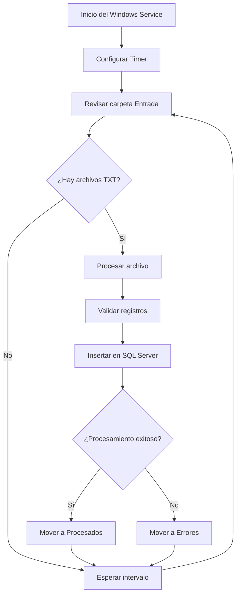

# ☕ CafeVirtualService

Windows Service desarrollado en C# con .NET Framework 4.8 para automatizar la lectura, validación y procesamiento de archivos TXT, e insertar sus registros en SQL Server.

Este proyecto demuestra cómo construir, configurar, instalar, ejecutar, depurar y administrar un Windows Service tradicional utilizando `ServiceBase`, separación de responsabilidades y acceso a datos mediante ADO.NET.

---

## 🎯 Objetivo del proyecto

Desarrollar un servicio de Windows capaz de ejecutarse en segundo plano, monitorear una carpeta de entrada y procesar automáticamente archivos TXT para importar sus registros a una base de datos SQL Server.

El servicio permite automatizar procesos de integración de datos sin necesidad de intervención manual.

---

## 🛠️ Tecnologías utilizadas

| Tecnología | Descripción |
|---|---|
| C# | Lenguaje de programación |
| .NET Framework 4.8 | Framework de desarrollo |
| Windows Services | Ejecución de procesos en segundo plano |
| SQL Server | Almacenamiento de datos |
| ADO.NET | Acceso a datos |
| System.Timers.Timer | Ejecución periódica de tareas |
| Event Viewer | Registro y monitoreo de eventos |
| Visual Studio | IDE de desarrollo |

---

## ⚙️ Funcionalidades

- Ejecución como Windows Service.
- Procesamiento automático de archivos TXT.
- Lectura de archivos delimitados por `|`.
- Validación de registros.
- Inserción de datos en SQL Server.
- Procesamiento por lotes.
- Manejo de excepciones.
- Organización de archivos procesados.
- Organización de archivos con errores.
- Configuración del intervalo de ejecución.
- Registro de eventos en Windows Event Viewer.
- Ejecución en modo Debug para pruebas.
- Instalación y administración mediante Windows Services.

---

## 🏗️ Arquitectura del proyecto

El proyecto utiliza una estructura organizada para separar responsabilidades y facilitar el mantenimiento y evolución del código.

```text
CafeVirtualService/
│
├── Entidades/
│   └── Registro.cs
│
├── Interfaces/
│   ├── IArchivoService.cs
│   └── IRegistroRepository.cs
│
├── Services/
│   └── ArchivoService.cs
│
├── Repositorios/
│   └── RegistroRepository.cs
│
├── Service1.cs
├── Service1.Designer.cs
├── ProjectInstaller.cs
├── Program.cs
└── App.config
```

### Responsabilidades

| Componente | Responsabilidad |
|---|---|
| `Service1` | Gestionar el ciclo de vida del servicio y coordinar el procesamiento. |
| `ArchivoService` | Leer, validar y procesar archivos TXT. |
| `RegistroRepository` | Ejecutar operaciones de acceso a SQL Server. |
| `Registro` | Representar los datos importados. |
| `IArchivoService` | Definir el contrato para el procesamiento de archivos. |
| `IRegistroRepository` | Definir el contrato para las operaciones de persistencia. |
| `ProjectInstaller` | Configurar la instalación del servicio en Windows. |
| `Program` | Punto de entrada de la aplicación. |

---

## 📂 Flujo de procesamiento



---

## 📄 Formato de archivos TXT

Los archivos de entrada utilizan el delimitador `|`.

### Encabezado

```text
Nombre|Email|FechaRegistro|Activo
```

### Ejemplo

```text
Nombre|Email|FechaRegistro|Activo
Pedro|pedro@hotmail.com|2026-08-22 20:11:51.7170000|1
Alejandro|alejandro@gmail.com|2026-08-23 09:15:30.1250000|1
Mariana|mariana@gmail.com|2026-08-23 10:22:45.5000000|1
Carlos|carlos@hotmail.com|2026-08-24 14:35:12.2500000|1
Daniel|daniel@gmail.com|2026-08-25 16:40:55.8900000|0
```

### Campos

| Campo | Tipo | Descripción |
|---|---|---|
| Nombre | String | Nombre del usuario. |
| Email | String | Correo electrónico. |
| FechaRegistro | DateTime | Fecha y hora del registro. |
| Activo | Boolean | Estado del usuario. |

El campo `Activo` admite valores `0`, `1`, `true` o `false`, de acuerdo con las validaciones implementadas.

---

## 🗄️ Base de datos

Base de datos utilizada:

```text
CafeVirtualDB
```

Tabla destino:

```sql
dbo.Usuarios
```

### Estructura de referencia

| Columna | Descripción |
|---|---|
| Id | Identificador del registro. |
| Nombre | Nombre del usuario. |
| Email | Correo electrónico. |
| FechaRegistro | Fecha de registro. |
| Activo | Estado del registro. |

---

## 🔧 Configuración

La configuración del servicio se realiza mediante el archivo `App.config`.

```xml
<?xml version="1.0" encoding="utf-8"?>
<configuration>

    <connectionStrings>
        <add name="DefaultConnection"
             connectionString="Server=localhost;Database=CafeVirtualDB;Integrated Security=True;TrustServerCertificate=True;"
             providerName="System.Data.SqlClient"/>
    </connectionStrings>

    <appSettings>
        <add key="CarpetaEntrada" value="C:\CafeVirtual\Entrada"/>
        <add key="CarpetaProcesados" value="C:\CafeVirtual\Procesados"/>
        <add key="CarpetaErrores" value="C:\CafeVirtual\Errores"/>
        <add key="Intervalo" value="30000"/>
    </appSettings>

</configuration>
```

### Parámetros de configuración

| Parámetro | Descripción |
|---|---|
| `DefaultConnection` | Cadena de conexión a SQL Server. |
| `CarpetaEntrada` | Directorio donde se reciben los archivos. |
| `CarpetaProcesados` | Directorio donde se almacenan los archivos procesados. |
| `CarpetaErrores` | Directorio donde se almacenan los archivos con errores. |
| `Intervalo` | Tiempo de espera entre ciclos de procesamiento, en milisegundos. |

### Intervalo de ejecución

El valor configurado es:

```xml
<add key="Intervalo" value="30000"/>
```

Equivale a:

```text
30,000 milisegundos = 30 segundos
```

El servicio revisará periódicamente la carpeta de entrada según el intervalo configurado y el ciclo de ejecución implementado.

---

## 🚀 Ejecución en modo Debug

Durante el desarrollo es posible ejecutar el servicio desde Visual Studio sin necesidad de instalarlo en Windows.

El modo Debug permite:

- Utilizar breakpoints.
- Inspeccionar variables.
- Analizar excepciones.
- Validar el procesamiento de archivos.
- Verificar conexiones a SQL Server.

### Ejecutar

1. Abrir el proyecto en Visual Studio.
2. Seleccionar la configuración `Debug`.
3. Ejecutar mediante `F5`.
4. Colocar archivos TXT en la carpeta de entrada configurada.
5. Validar el procesamiento.

El proyecto implementa un modo de ejecución de consola para facilitar las pruebas durante el desarrollo.

---

## 📦 Instalación en Windows

### 1. Compilar el proyecto

En Visual Studio:

1. Seleccionar la configuración `Release`.
2. Compilar la solución.
3. Ubicar el ejecutable generado.

Ruta de referencia:

```text
bin\Release\CafeVirtualService.exe
```

### 2. Instalar el servicio

Abrir CMD como administrador.

Ejecutar:

```cmd
C:\Windows\Microsoft.NET\Framework64\v4.0.30319\InstallUtil.exe "C:\Ruta\CafeVirtualService.exe"
```

Reemplazar la ruta por la ubicación real del ejecutable.

### 3. Iniciar el servicio

```cmd
sc start CafeVirtualService
```

### 4. Consultar el estado

```cmd
sc query CafeVirtualService
```

### 5. Detener el servicio

```cmd
sc stop CafeVirtualService
```

### 6. Desinstalar el servicio

```cmd
C:\Windows\Microsoft.NET\Framework64\v4.0.30319\InstallUtil.exe /u "C:\Ruta\CafeVirtualService.exe"
```

---

## 🖥️ Administración desde Windows

También es posible administrar el servicio mediante la consola de servicios de Windows.

Ejecutar:

```cmd
services.msc
```

Desde esta consola es posible:

- Iniciar el servicio.
- Detener el servicio.
- Reiniciar el servicio.
- Configurar el tipo de inicio.
- Configurar la cuenta de ejecución.

### Configuración de inicio

| Tipo | Descripción |
|---|---|
| Automatic | Inicia automáticamente durante el arranque de Windows. |
| Manual | Permite iniciar el servicio manualmente. |
| Disabled | Impide el inicio del servicio. |

---

## 🔐 Seguridad y permisos

El servicio puede ejecutarse bajo diferentes cuentas de Windows.

La cuenta configurada debe contar con los permisos necesarios para:

- Acceder a las carpetas de entrada.
- Mover archivos a las carpetas de procesamiento.
- Acceder a SQL Server.
- Ejecutar las operaciones de base de datos requeridas.

### Windows Authentication

La conexión a SQL Server utiliza autenticación integrada de Windows:

```text
Integrated Security=True
```

La identidad utilizada para conectarse a SQL Server dependerá de la cuenta bajo la cual se ejecuta el servicio.

### LocalSystem

Cuando el servicio se ejecuta bajo `LocalSystem`, SQL Server puede identificarlo como:

```text
NT AUTHORITY\SYSTEM
```

En este escenario, el Login de Windows debe existir en SQL Server y contar con los permisos necesarios sobre la base de datos.

> Se recomienda utilizar una cuenta de servicio dedicada con privilegios mínimos en entornos productivos.

---

## 📋 Registro de eventos

El servicio utiliza Windows Event Viewer para registrar información relacionada con su ejecución.

Los eventos pueden incluir:

- Inicio del servicio.
- Detención del servicio.
- Procesamiento exitoso.
- Errores durante la importación.
- Excepciones de SQL Server.

### Consultar los eventos

Ejecutar:

```cmd
eventvwr.msc
```

Ruta:

```text
Visor de eventos
└── Registros de Windows
    └── Aplicación
```

Buscar los eventos correspondientes a:

```text
CafeVirtualService
```

---

## 🧪 Escenarios de prueba

| Escenario | Resultado esperado |
|---|---|
| TXT válido | Registros insertados correctamente. |
| TXT sin registros | No se insertan datos. |
| Fecha inválida | Registro o archivo rechazado según la validación implementada. |
| Valor `Activo` inválido | Registro rechazado. |
| SQL Server desconectado | Error registrado. |
| Archivo con formato incorrecto | Archivo enviado a la carpeta de errores. |
| Servicio detenido | No se ejecutan nuevos ciclos. |

